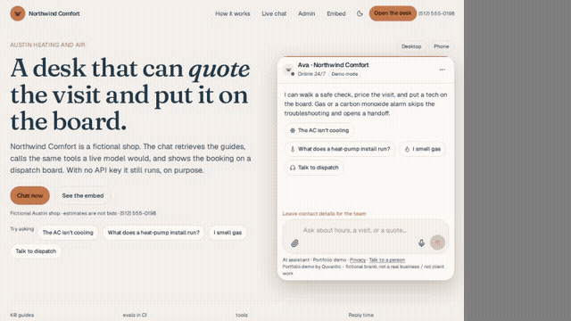
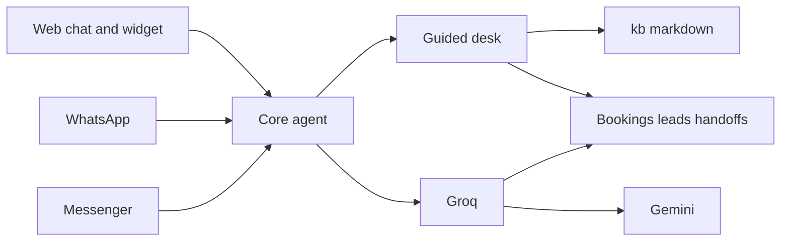

# Northwind Comfort chat



Portfolio demo by Quvantic - fictional brand, not a real business / not client work.

**Northwind Comfort Heating & Air** is a made-up Austin shop. The chat takes a homeowner from a problem to a safe check, a sample price, an arrival window, and a confirmation card. Gas and carbon monoxide skip the troubleshooting and open a handoff. Nothing here pages a real technician.

Live demo (when deployed): [https://hvac-chat.quvantic.com](https://hvac-chat.quvantic.com)

Author: Muhammad Mustafa · [mustafaautomation](https://github.com/mustafaautomation) · Quvantic

## What’s in it

- Landing page with an architecture walk-through, plus the full chat at `/chat`.
- Embeddable widget: one script tag injects a launcher and an iframe. Try it on `/embed-demo`.
- Retrieval over 24 markdown guides in `kb/`, chunked and ranked with BM25 plus a local hash embedding. No paid vector API. Answers cite the guide. Low confidence opens a handoff instead of guessing.
- Tools, validated with Zod, against a mock board: service area, itemized quote, slots, book, lookup, reschedule, cancel, CRM lead, emergency dispatch.
- Human handoff for “talk to a person,” frustration, sensitive payment digits, and questions the guides don’t cover. `/admin` shows the calendar, leads, handoffs, and the conversation inbox with tool calls.
- WhatsApp Cloud API and Messenger webhooks call the same agent. See [docs/channels.md](docs/channels.md).
- Guardrails: prompt-injection refusal, off-topic refusal, PII masked in logs.
- Offline demo engine so the desk still works with zero API keys. Optional Groq (`llama-3.3-70b-versatile`) with Gemini (`gemini-2.0-flash`) as fallback.

## Architecture



Gas, carbon monoxide, injection, and frustration never reach the model. They stay on the guided desk.

## Embed

```html
<script src="https://hvac-chat.quvantic.com/widget.js" data-title="Chat with Northwind" async></script>
```

The script adds a button, then an iframe of `/widget`. Escape is handled on the host page when focus is outside the frame. Close returns focus to the button.

## Run it

Node.js 22.

```bash
npm install
npm run dev
```

Chat: [http://localhost:4317/chat](http://localhost:4317/chat). Board: [http://localhost:4317/admin](http://localhost:4317/admin). Widget host: [http://localhost:4317/embed-demo](http://localhost:4317/embed-demo).

No keys required. Copy `.env.example` to `.env.local` only if you want Groq or Gemini to choose the tools. The **Use model** button appears when a key is present. If the model call fails, the guided desk answers.

```bash
npm test          # unit tests, including channel payloads
npm run eval      # 24 offline cases, writes docs/eval-report.md
npm run typecheck
npm run lint
npm run build
npm run test:e2e  # Playwright: citation, booking, handoff, widget, mobile
```

`npm run build` needs no environment variables.

## Eval results

Offline demo engine, 24 cases, 0 failed. Full notes: [docs/eval-report.md](docs/eval-report.md).

| Group | Cases | Result |
| --- | --- | --- |
| RAG answer and citation | 8 | pass |
| Tool choice and arguments | 8 | pass |
| Handoffs | 5 | pass |
| Guardrails | 3 | pass |

Screenshots: `docs/screenshots/`.

## Deploy

The app is a Next.js project with `vercel.json`. On Vercel, import the repo and leave the env empty for the guided desk, or set the keys from `.env.example`.

Suggested host: `hvac-chat.quvantic.com`.

Point the WhatsApp and Messenger webhooks at `/api/webhooks/whatsapp` and `/api/webhooks/messenger`. The verify token defaults to `northwind-demo`. Outbound Graph calls are skipped until `WHATSAPP_TOKEN` or `MESSENGER_PAGE_TOKEN` is set.

## The visit

1. Open the chat and send the AC that will not cool, with square footage, age, and a ZIP.
2. Read the safe checks, the itemized range, and the guide citation.
3. Pick a window, use the sample customer, and confirm.
4. The code `NW-####` is on the dispatch board.

A gas smell returns the leave-and-call-911 message and an `HW-####` handoff. It does not suggest a filter change.

Portfolio demo by Quvantic - fictional brand, not a real business / not client work.
